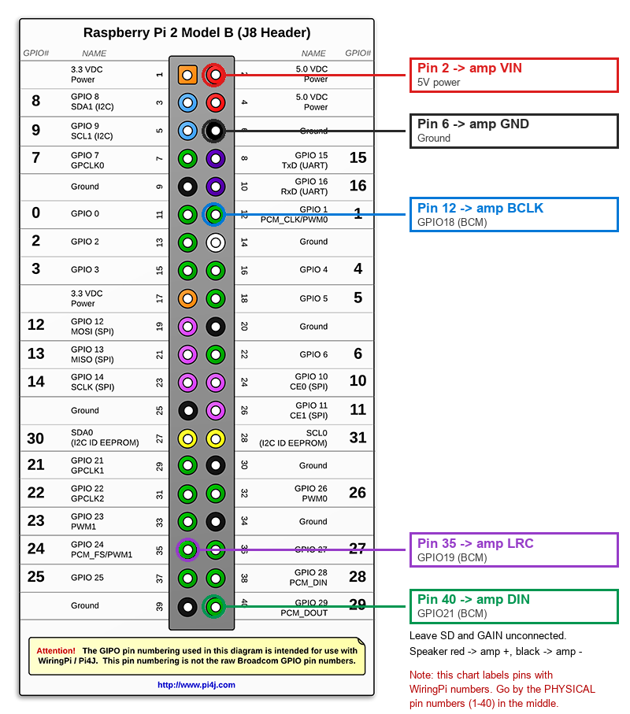

# Audio

The Pi Zero 2 W has no audio output of its own, and a speaker can't be driven from a GPIO pin. Sound goes out over I2S to a MAX98357A amp board, which drives a 20x30 mm 8 ohm 1 W speaker.

## Parts

- MAX98357A I2S class D amp breakout (Adafruit 3006 or one of the cheap clones, same pins)
- 20x30 mm 8 ohm 1 W speaker with bare leads

## Wiring

| Amp pin | Pi pin | Physical pin |
|---|---|---|
| VIN | 5V | 2 or 4 |
| GND | GND | 6 (or any GND) |
| BCLK | GPIO18 | 12 |
| LRC | GPIO19 | 35 |
| DIN | GPIO21 | 40 |
| SD | leave unconnected | |
| GAIN | leave unconnected (9 dB) | |
| Speaker + / - | speaker leads | |



Go by the physical pin numbers. Pin 1 is the square pad, at the SD card end, and odd pins are on the inner row. It's easy to wire the header mirrored if you're working from the underside, which is what happened the first time here: nothing broke, there was just no sound.

None of these clash with anything else on the device. The Display HAT Mini uses SPI0 (GPIO 7 to 11), GPIO13 for the backlight, GPIO 5/6/16/24 for its buttons and GPIO 17/27/22 for the LED. The pad and UPS HAT are on I2C (GPIO 2 and 3).

Notes:

- The speaker connects only to the amp's two speaker terminals. Never tie either speaker lead to GND, the output is bridged.
- Speaker polarity doesn't matter for a single speaker.
- GAIN unconnected is 9 dB. Tested at 9 dB and the software volume at 100% it's clearly audible but not loud with the bare speaker. A sealed enclosure behind a grille will help most. For more, tie GAIN to GND (12 dB) or to GND through 100k (15 dB). Tie it to VIN (6 dB) if it distorts.
- speaker-test plays one channel at a time, and with SD floating the amp outputs (L+R)/2, so test tones sound quieter than stereo game audio.
- The SD pin has a pull-up on the board that turns the amp on and mixes left and right, which is what we want for one speaker.

## Software

Run on the Pi from the repo, then reboot:

```
bash setup/enable-audio.sh
sudo reboot
```

This:

- adds `dtoverlay=max98357a,no-sdmode` to `/boot/firmware/config.txt`
- sets `dtparam=audio=off` (there's no analogue out on the Zero, and HDMI audio isn't used)
- installs `setup/asound.conf` as `/etc/asound.conf`, which makes the amp the default device, adds a software `Master` volume and uses dmix so more than one program can play at once

## Testing

```
bash pi-tests/test_speaker.sh
```

`aplay -l` should list a `MAX98357A` card, then you should hear a tone and the "front left, front right" voice. Change the volume with `alsamixer` or `amixer sset Master 70%`, then `sudo alsactl store` to keep it across reboots. It's stored at 100%.

## RetroArch

`config/retroarch.cfg` uses the `alsathread` driver on the default device at 48 kHz with 128 ms latency, and the dmix buffer in `setup/asound.conf` is 8192 frames (Adafruit's recommended size for this amp). Reinstall with `bash setup/install-retroarch-config.sh` and restart `pokepi-retroarch.service`.

Getting smooth sound took a few changes together. With the plain `alsa` driver, 64 ms latency and a 4096 frame dmix buffer, music was badly choppy even in Game Boy games where the CPU was 90% idle:

- `video_vsync = "false"` and `video_threaded = "true"`. The SPI panel tops out around 50 fps, and waiting on it held the emulator below 60, starving the audio.
- `audio_driver = "alsathread"`, `audio_latency = "128"` and the bigger dmix buffer.

GBA is a separate problem: mGBA runs Pokémon Emerald at 100% of one core on the Zero 2 W, so it can still stutter there. `mgba_frameskip = "auto"` and `mgba_skip_bios = "ON"` are set in `~/.config/retroarch/config/mGBA/mGBA.opt` (copy in `config/mGBA.opt`).
