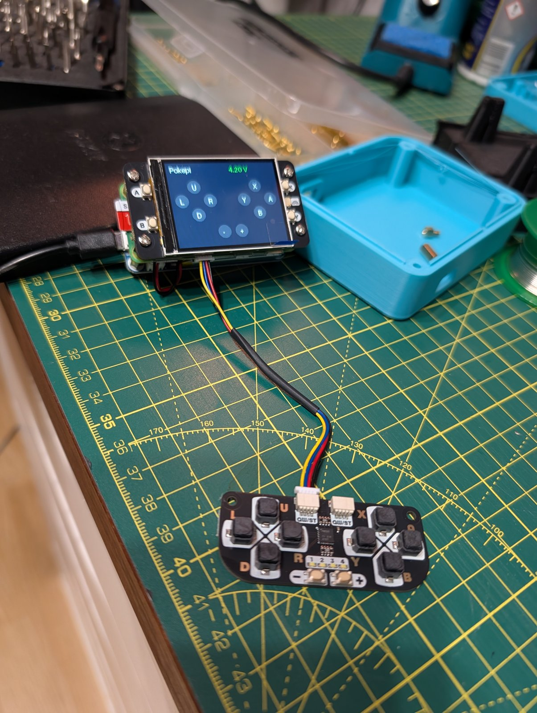
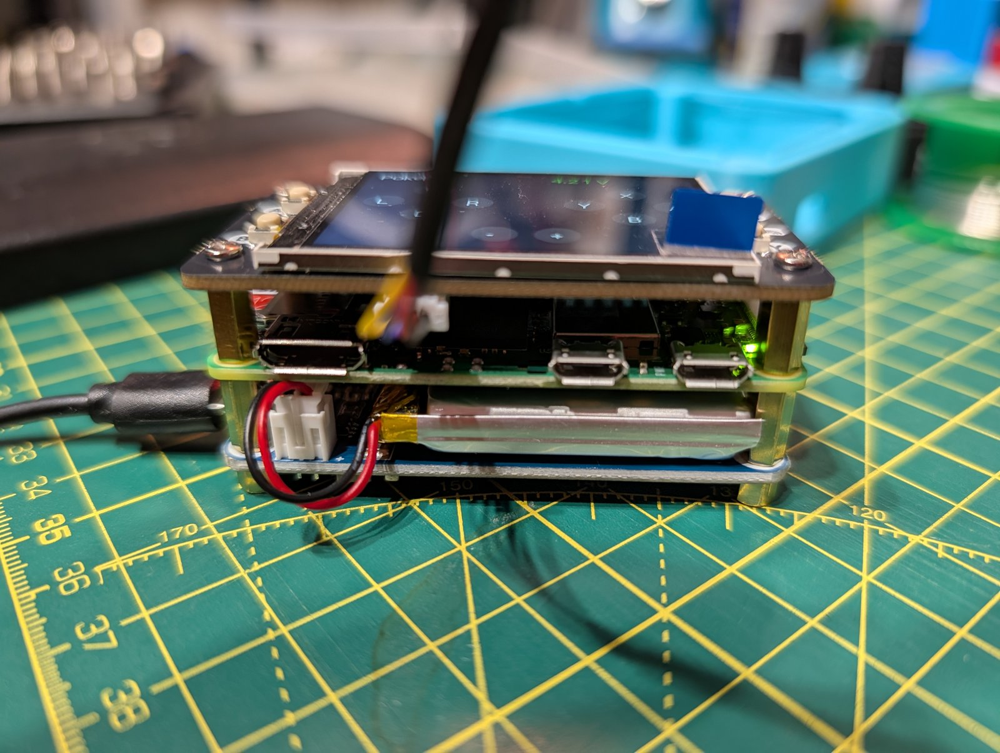

# Build log

Progress photos and notes from building Pokepi, for a blog post and project page later on.

Photos go in `photos/`, named by date first so they sort in order (for example `2026-11-20-pad-wired.jpg`). They're resized to 1600px and have their metadata stripped before they go in the repo. The full-size originals stay in `originals/`, which git ignores.

## 2026-11-20

First proper bring-up on the bench. The screen, pad and UPS are all talking to the Pi. The screen took the longest, it needed a custom overlay to free up GPIO9 before it would show anything (see [bring-up notes](../bring-up.md)).

The Display HAT Mini is running `test_all.py`, which draws every pad button and lights it up when pressed. The battery reads 4.20 V in the top corner. The Qw/ST Pad hangs off the Pi on its I2C cable for now. In the background is one of the printed case parts in blue.

Side view of the stack on brass standoffs. Display HAT Mini on top, Pi Zero 2 W in the middle and the Waveshare UPS HAT with its LiPo on the bottom. It's about 3 boards thick, which the case has to fit around.
