# Build log

Progress photos and notes from building Pokepi, for a blog post and project page later on.

Photos go in `photos/`, named by date first so they sort in order (for example `2026-11-20-pad-wired.jpg`). They're resized to 1600px and have their metadata stripped before they go in the repo. The full-size originals stay in `originals/`, which git ignores.

## 2026-11-20

First proper bring-up on the bench. The screen, pad and UPS are all talking to the Pi. The screen took the longest, it needed a custom overlay to free up GPIO9 before it would show anything (see [bring-up notes](../bring-up.md)).

The Display HAT Mini is running `test_all.py`, which draws every pad button and lights it up when pressed. The battery reads 4.20 V in the top corner. The Qw/ST Pad hangs off the Pi on its I2C cable for now. In the background is one of the printed case parts in blue.

Side view of the stack on brass standoffs. Display HAT Mini on top, Pi Zero 2 W in the middle and the Waveshare UPS HAT with its LiPo on the bottom. It's about 3 boards thick, which the case has to fit around.

## 2026-11-22

Wiring up the speaker amp. It's a MAX98357A I2S board, wired to 5 header pins on the Pi Zero 2 W (5V, GND and GPIO 18, 19 and 21). The Display HAT covers the header, so the wires are soldered to the joints from the underside. Wiring is in [audio.md](../audio.md).

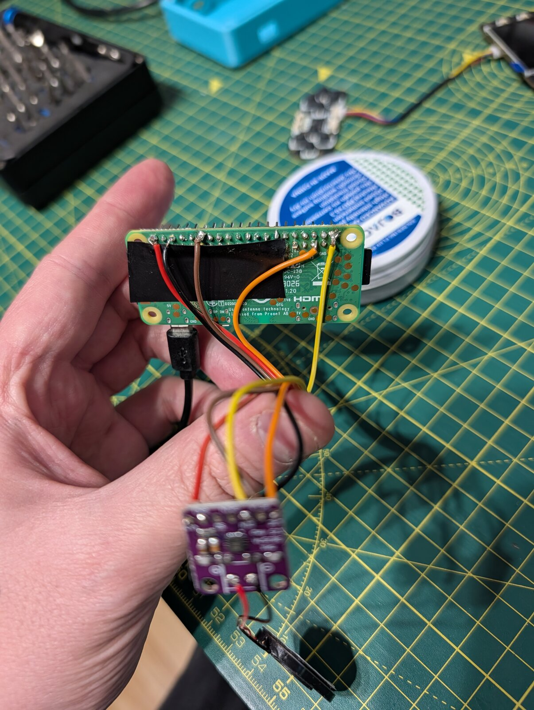

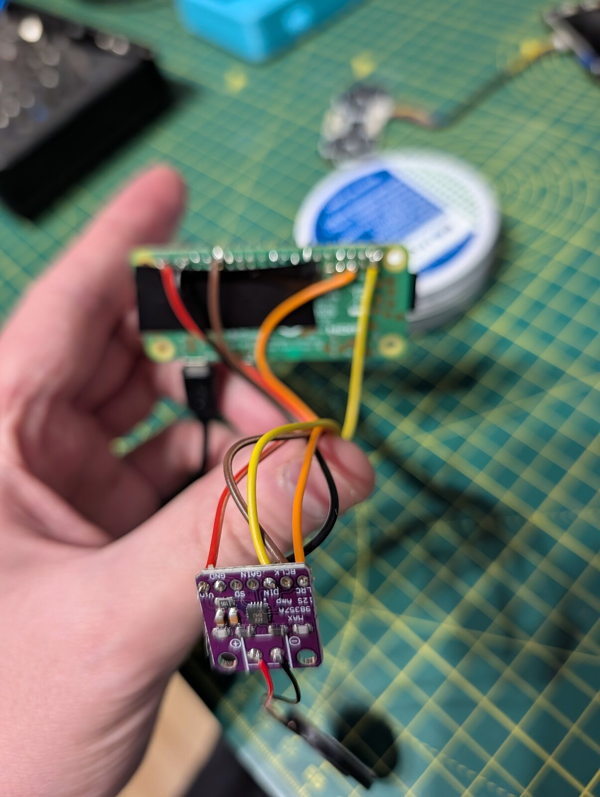

## 2026-11-23

The amp and the 20 x 30 mm 8 ohm speaker on the mat, ready to test.

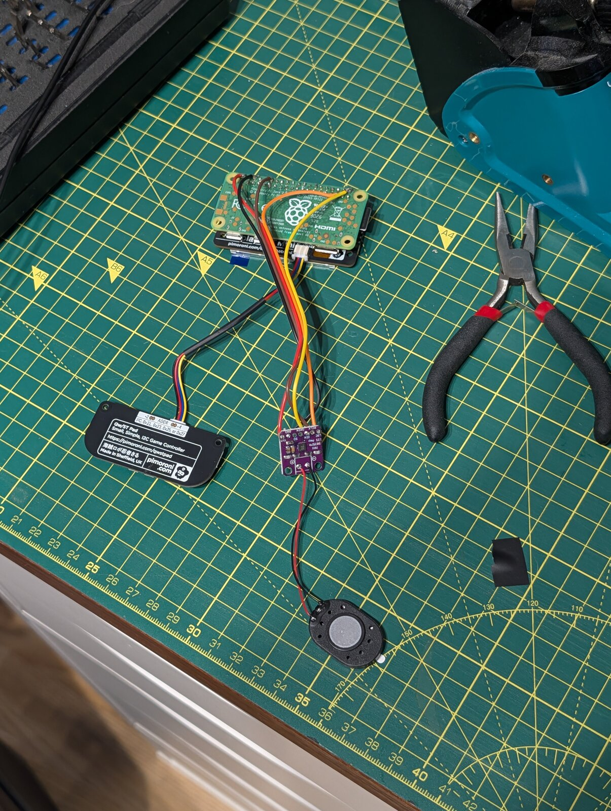

## 2026-11-24

First sound. Pokémon running in RetroArch with the music coming out of the speaker. Getting it smooth took threaded video, vsync off and bigger audio buffers (see [audio.md](../audio.md)).

[Video: first sound from the speaker (2026-11-24-first-sound.mp4)](photos/2026-11-24-first-sound.mp4)

First test print of the Strata 2 case, with fit notes written on in pen.

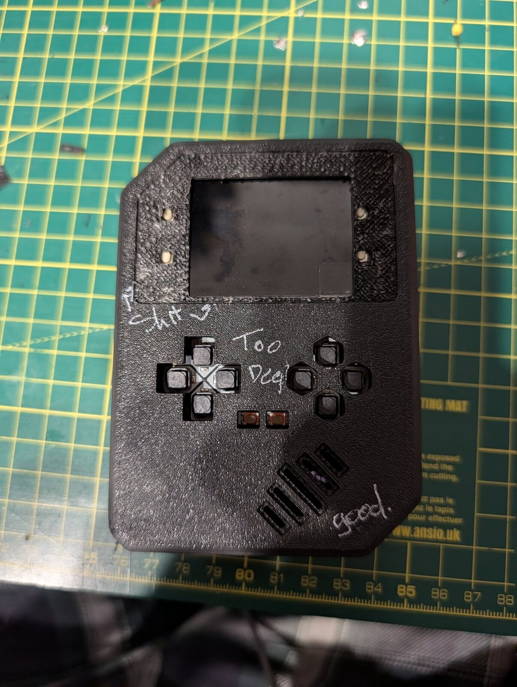

The front. The keys sit too deep and the screen bezel pocket left a mess of support. The speaker slashes came out well.

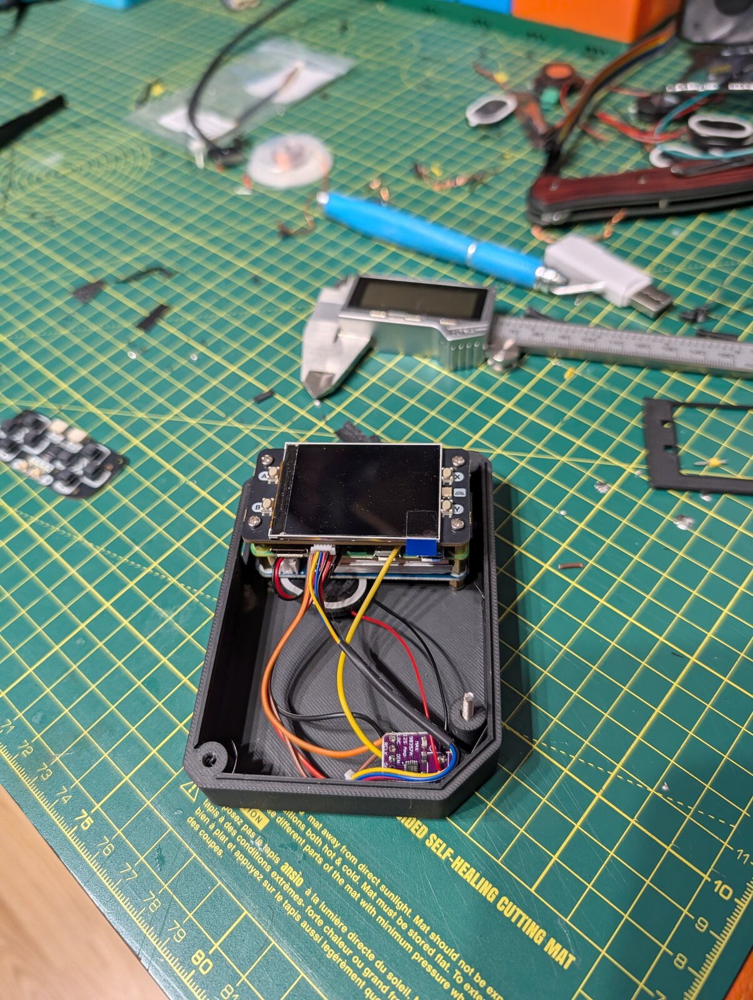

The stack, pad, amp and speaker laid into the shells for the first time.

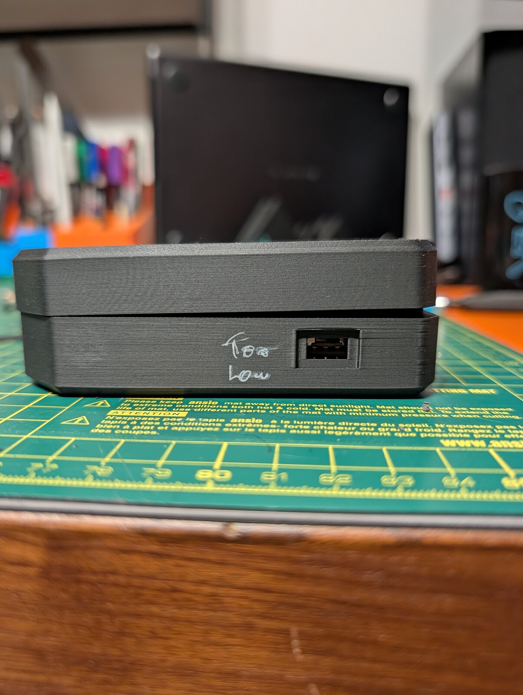

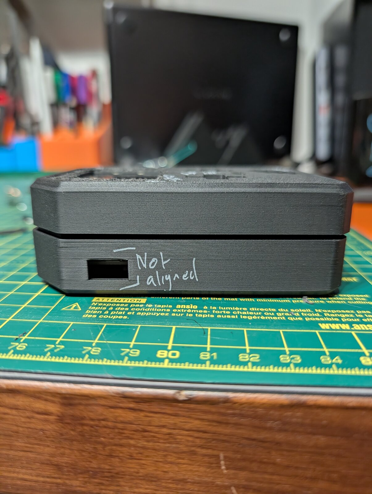

The side port cutouts were too low and too far in, so they didn't line up with the USB-C socket and the power switch.

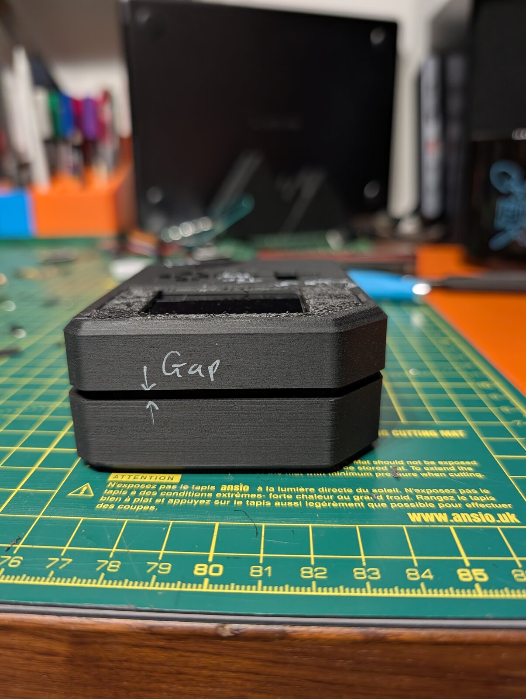

The stack was deeper than the case allowed, so the halves don't close. The stack measures 33 mm, and the case is now 2.5 mm deeper.

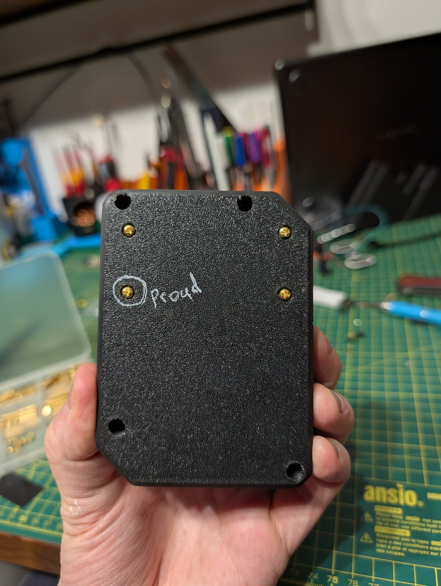

The back screws sit proud. The next version has deeper counterbores. The heat-set insert slots fitted perfectly.

All of these are fixed in the next version of the case.

## 2026-11-27

Every version of the case so far, V0 in yellow and V2 to V5 in black, with the pad brackets and D-pad test keys in front. I write on each test print with acrylic markers as I try it, so every old version still has its notes on it.

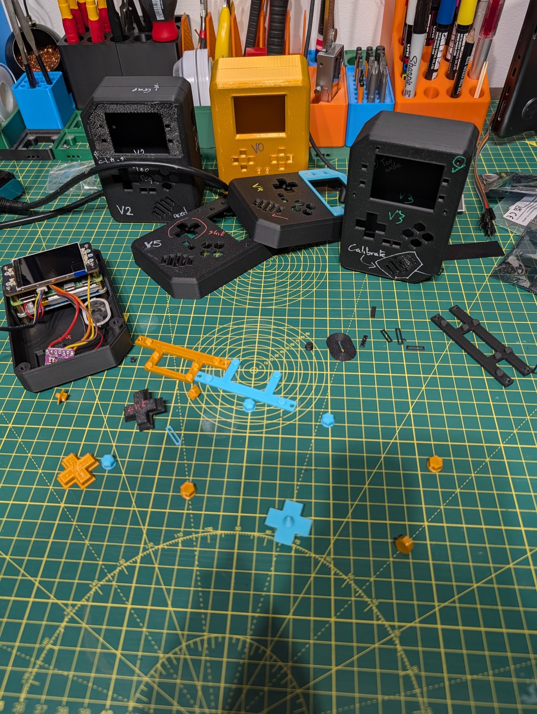

The current build opened up. The front shell has the pad held in by its bracket, the back has the screen stack, the amp and the speaker.

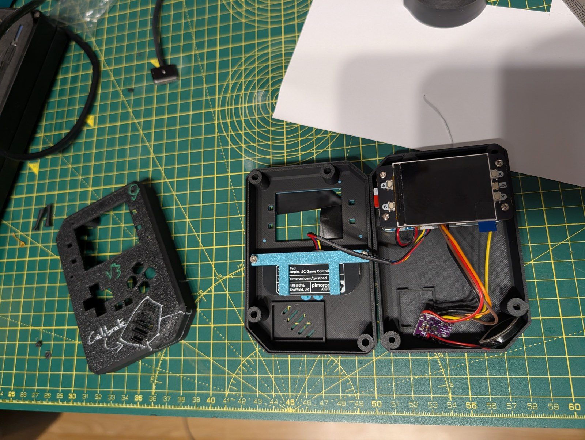

The case design is Strata, a chamfered slab with 5 speaker slashes printed as separate inserts.

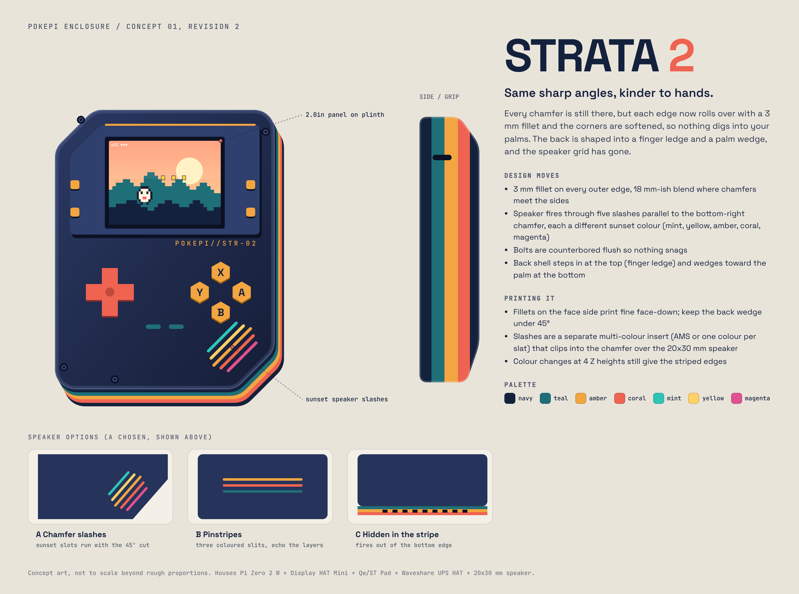

The D-pad has been the hardest part. The one-piece rocker never pressed its switches, so these were the 5 options after it. I went with the pinwheel wedges, without the centre hub.

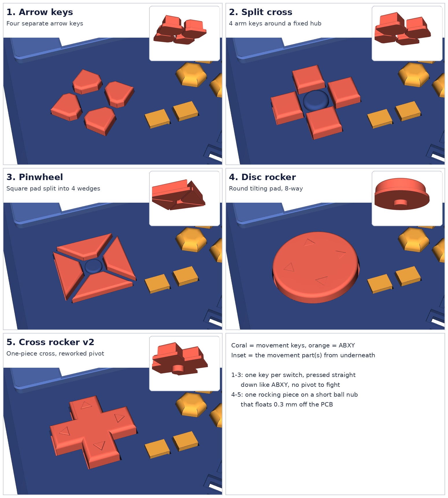

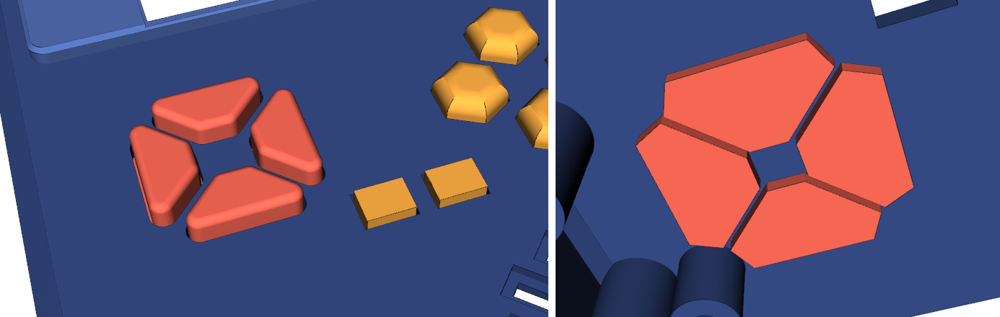
